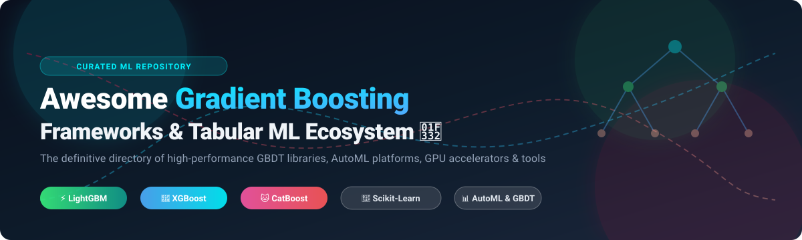

# Awesome-Gradient-Boosting-Frameworks

<p align="center">
  
</p>

<p align="center">
  <a href="https://github.com/ishandutta2007/Awesome-Awesome-Awesome"></a><a href="https://discord.gg/jc4xtF58Ve"></a>
  <a href="https://github.com/ishandutta2007/Awesome-Gradient-Boosting-Frameworks/stargazers"></a>
  <a href="https://github.com/ishandutta2007/Awesome-Gradient-Boosting-Frameworks/network/members"></a>
  <a href="https://github.com/ishandutta2007/Awesome-Gradient-Boosting-Frameworks/issues"></a>
  <a href="https://github.com/ishandutta2007/Awesome-Gradient-Boosting-Frameworks/blob/main/LICENSE"></a>
  <a href="https://github.com/ishandutta2007"></a>
</p>

---

## 🌲 Top Gradient Boosting Frameworks & Tabular ML Ecosystem

> **A curated, battle-tested list of leading SaaS AutoML platforms and open-source GitHub projects specializing in Gradient Boosted Decision Trees (GBDT), tabular machine learning, distributed GPU/CPU training, and ensemble methods.**

**Last updated: October 2026** 📅

This repository tracks the premier **SaaS platforms** and **open-source libraries** driving **Gradient Boosting Frameworks**. Gradient Boosted Decision Trees remain the undisputed gold standard for structured and tabular data modeling—dominating Kaggle competitions, algorithmic trading desks, risk scoring engines, and enterprise production environments. In GBDT, weak learners (typically decision trees) are sequentially constructed to iteratively minimize residual errors, yielding superior accuracy, interpretability, and execution speed.

### 🔍 Key Framework Highlights
- **The Big Three Champions**: **[XGBoost](https://github.com/dmlc/xgboost)** (deepest CUDA/GPU acceleration and battle-tested production pedigree), **[LightGBM](https://github.com/microsoft/LightGBM)** (Microsoft's leaf-wise histogram champion for lightning-fast CPU training), and **[CatBoost](https://github.com/catboost/catboost)** (Yandex's categorical specialist with ordered boosting to combat target leakage).
- **Enterprise & Scaled ML**: **[Apache Spark MLlib](https://spark.apache.org/)** and **[H2O-3](https://github.com/h2oai/h2o-3)** for petabyte-scale distributed training clusters.
- **AutoML & Ensembling**: Multi-layer stacked ensembles combining boosted trees via **[AutoGluon](https://github.com/autogluon/autogluon)** and **[PyCaret](https://github.com/pycaret/pycaret)**.
- **Probabilistic Modeling & Explainability**: Uncertainty quantification with **[NGBoost](https://github.com/stanfordmlgroup/ngboost)** and state-of-the-art model interpretability using **[InterpretML](https://github.com/interpretml/interpret)**.

---

## 📑 Table of Contents
- [📊 Sector Overview & Market Dynamics](#-sector-overview--market-dynamics)
- [💼 SaaS & Enterprise Hosted Platforms](#-saas--enterprise-hosted-platforms)
- [⚡ Open-Source GitHub Projects](#-open-source-github-projects)
- [🛠️ Decision Guide: Which Framework to Choose?](#️-decision-guide-which-framework-to-choose)
- [🤝 How to Contribute](#-how-to-contribute)
- [💖 Support & Sponsorship](#-support--sponsorship)
- [⭐ Star History](#-star-history)
- [⚖️ Disclaimer](#️-disclaimer)

---

## 📊 Sector Overview & Market Dynamics

The global market for automated tabular machine learning and data science platforms is valued between **$2.5 billion and $3.6 billion**, rapidly expanding at an estimated **CAGR of ~38% to 42%** toward a projected **$15B–$50B+** over the next decade. 

The sector is **moderately fragmented** rather than a winner-take-all monopoly: while cloud hyperscalers (AWS, Azure, Google Cloud) capture substantial raw compute spend, independent enterprise pure-plays (such as Altair, Alteryx, DataRobot, and H2O.ai) maintain sticky enterprise footholds by offering vendor-agnostic deployments, governed visual pipelines, robust on-premise capabilities, and best-of-breed tabular AutoML engines.

---

## 💼 SaaS & Enterprise Hosted Platforms

The following hosted platforms and enterprise suites provide end-to-end automated machine learning (AutoML), visual workflow orchestrators, and enterprise deployments featuring integrated gradient boosted decision trees. Entries are ranked in descending order by **Company Size / Valuation / Enterprise Revenue**.

| Platform | Company Size (Valuation / Revenue) | Overview & Gradient Boosting Capabilities | Pricing (Starting Tier) | Free Tier / Trial Limits |
| :--- | :--- | :--- | :--- | :--- |
| **[Altair RapidMiner](https://rapidminer.com/)** | **~$10.6B Acquisition** (Acquired by Siemens AG; publicly listed enterprise value prior to deal) | Visual data science studio with drag-and-drop workflow pipelines and integrated gradient boosting operators (XGBoost, LightGBM wrappers). Ideal for visual analysts and cross-functional enterprise teams. | Professional tiers start at ~$2,500/user/year (or via Altair Units) | Free tier available; strictly capped at 10,000 data rows per process/dataset and 1 logical processor/thread. |
| **[DataRobot](https://www.datarobot.com/)** | **~$6.3B Valuation** (Series G peak; ~$100M+ ARR) | End-to-end enterprise AI platform with autonomous tabular modeling, automated feature engineering, and robust gradient boosting ensemble backends. Tailored for enterprise MLOps governance. | Enterprise deployments start at ~$50,000/year | 30-day free trial (capped at shared modeling workers, 15 vector DBs, and 1,000 LLM calls; workspace transitions to read-only upon expiration). |
| **[Alteryx](https://www.alteryx.com/)** | **~$4.4B Acquisition** (Acquired by Clearlake & Insight Partners; ~$970M annual revenue) | Enterprise analytics automation and data preparation platform with predictive modeling extensions including GBDT classification and regression. | Starter Edition starts at $250/user/month ($3,000/user/year, billed annually) | 30-day free trial (Alteryx One platform access; Starter tier capped to 10 users max and 0 scheduled automation runs). |
| **[H2O.ai](https://www.h2o.ai/)** | **~$1.7B Valuation** (Series E valuation led by Goldman Sachs) | Commercial enterprise AI platform featuring Driverless AI (automated tabular GBDT modeling) and enterprise support for the open-source H2O-3 distributed engine with native XGBoost integration. | Enterprise subscriptions start at ~$25,000/year (Driverless AI single-node) | 90-day free trial on H2O AI Cloud; Driverless AI offers a 21-day public cloud trial license or 2-hour cloud test drive (open-source H2O-3 is free forever under Apache 2.0). |
| **[KNIME](https://www.knime.com/)** | **~€30M ARR** (Series B funding backed by Invus) | Open-for-innovation data analytics ecosystem with visual workflows and extension nodes for XGBoost, LightGBM, and H2O. Combines self-hosted desktop analytics with collaborative cloud hubs. | KNIME Community Hub Pro starts at $19/month ($99/month for Team tier) | Free forever Community Hub Personal plan (public spaces, 20 K-AI interactions/month); desktop open-source Analytics Platform is 100% free with no scheduling. |

---

## ⚡ Open-Source GitHub Projects

The premier open-source frameworks for gradient boosted trees, tabular deep learning ensembles, and model interpretability. Sorted in descending order by **GitHub Star Count**.

| Project | Stars | Primary Focus | Best For | License |
| :--- | :--- | :--- | :--- | :--- |
| **[Scikit-learn](https://github.com/scikit-learn/scikit-learn)** | [](https://github.com/scikit-learn/scikit-learn/stargazers) | `HistGradientBoosting` & Classical GBDT | Zero-dependency baseline modeling within standard Python ML pipelines | BSD-3-Clause |
| **[Apache Spark (MLlib)](https://github.com/apache/spark)** | [](https://github.com/apache/spark/stargazers) | Distributed `GBTClassifier` & `GBTRegressor` | Multi-node cluster training on massive datasets already residing in Spark | Apache-2.0 |
| **[XGBoost](https://github.com/dmlc/xgboost)** | [](https://github.com/dmlc/xgboost/stargazers) | Battle-tested Extreme Gradient Boosting | GPU-accelerated training, custom objectives, multi-language pipelines | Apache-2.0 |
| **[LightGBM](https://github.com/microsoft/LightGBM)** | [](https://github.com/microsoft/LightGBM/stargazers) | Leaf-wise Histogram Gradient Boosting | High-speed, memory-efficient CPU training on large-scale tabular datasets | MIT |
| **[AutoGluon](https://github.com/autogluon/autogluon)** | [](https://github.com/autogluon/autogluon/stargazers) | Multi-Layer Stacked Tabular AutoML | Automated multi-model ensembling combining LightGBM, CatBoost, and XGBoost | Apache-2.0 |
| **[PyCaret](https://github.com/pycaret/pycaret)** | [](https://github.com/pycaret/pycaret/stargazers) | Low-Code Machine Learning Library | Rapid prototyping and automatic benchmark comparison across GBDT frameworks | MIT |
| **[CatBoost](https://github.com/catboost/catboost)** | [](https://github.com/catboost/catboost/stargazers) | Categorical Feature Specialist with Oblivious Trees | Datasets dominated by categorical and text features with minimal tuning required | Apache-2.0 |
| **[H2O-3](https://github.com/h2oai/h2o-3)** | [](https://github.com/h2oai/h2o-3/stargazers) | In-Memory Distributed ML & Tabular AutoML | Scalable distributed gradient boosting in Java, Python, and R | Apache-2.0 |
| **[InterpretML](https://github.com/interpretml/interpret)** | [](https://github.com/interpretml/interpret/stargazers) | Explainable Boosting Machines (EBM) | High-stakes tabular modeling where glass-box interpretability is strictly mandated | MIT |
| **[NGBoost](https://github.com/stanfordmlgroup/ngboost)** | [](https://github.com/stanfordmlgroup/ngboost/stargazers) | Natural Gradient Boosting for Probabilistic Prediction | Estimating uncertainty intervals and predicting full probability distributions | Apache-2.0 |

---

### Detailed Open-Source Breakdown 🔬

- **[Scikit-learn HistGradientBoosting](https://github.com/scikit-learn/scikit-learn)**  
  Scikit-learn's native gradient boosting implementation, inspired by LightGBM. BSD licensed.
  - **Strengths**: Zero external dependencies if you already use scikit-learn, consistent API, and direct integration into standard Pipelines and GridSearchCV.
  - **Trade-offs**: CPU only (no GPU acceleration), slower on ultra-large datasets compared to native C++ implementations.
  - **Best for**: Teams seeking clean, lightweight baselines without extraneous external binaries.

- **[Apache Spark (MLlib)](https://github.com/apache/spark)**  
  Scalable distributed machine learning library containing GBTClassifier and GBTRegressor built right into Apache Spark.
  - **Strengths**: Native execution on distributed Hadoop/YARN or Kubernetes clusters, effortlessly handling terabyte-scale tabular sets.
  - **Trade-offs**: Slower on single machines due to Spark orchestration overhead; less cutting-edge tree pruning heuristics than XGBoost/LightGBM.
  - **Best for**: Big data pipelines where datasets already live across Spark clusters.

- **[XGBoost](https://github.com/dmlc/xgboost)**  
  The world-renowned battle-tested gradient boosting framework. Apache 2.0 licensed.
  - **Strengths**: Industry-standard CUDA GPU support, asynchronous GPU memory pooling, multi-target vector-leaf trees, and broad language bindings (Python, R, JVM, C++, Rust).
  - **Trade-offs**: More hyperparameter tuning levers required to achieve optimum performance.
  - **Best for**: Production systems and competitive ML where maximum GPU throughput and fine-grained algorithmic control are essential.

- **[LightGBM](https://github.com/microsoft/LightGBM)**  
  Microsoft's histogram-based gradient boosting framework. MIT licensed.
  - **Strengths**: Highly efficient leaf-wise (best-first) tree growth, histogram binning, and low RAM consumption making it the undisputed CPU speed champion.
  - **Trade-offs**: Susceptible to overfitting on smaller sample sizes without tuning `num_leaves` and `min_child_samples`.
  - **Best for**: CPU-bound production environments, real-time latency budgets, and sparse high-dimensional data.

- **[AutoGluon](https://github.com/autogluon/autogluon)**  
  AWS's powerful automated machine learning framework specializing in tabular data. Apache 2.0 licensed.
  - **Strengths**: Multi-layer stacking and bagging across LightGBM, CatBoost, XGBoost, and deep neural nets with practically zero manual tuning required.
  - **Trade-offs**: Higher resource and compute demands during automated ensembling searches.
  - **Best for**: Practitioners aiming for competitive state-of-the-art results out of the box.

- **[PyCaret](https://github.com/pycaret/pycaret)**  
  Low-code machine learning library in Python that accelerates workflow automation. MIT licensed.
  - **Strengths**: Compares dozens of baseline GBDT models in a single line of code with automated preprocessing, hyperparameter tuning, and model analysis.
  - **Trade-offs**: Abstraction layer can add overhead; not built for custom algorithmic tree alterations.
  - **Best for**: Citizen data scientists, rapid prototyping, and quick baseline evaluations.

- **[CatBoost](https://github.com/catboost/catboost)**  
  Yandex's gradient boosting engine featuring symmetric oblivious trees and ordered boosting. Apache 2.0 licensed.
  - **Strengths**: State-of-the-art native handling of categorical features and text features without manual target encoding; immune to prediction shift and target leakage.
  - **Trade-offs**: Slower training times on purely numeric tabular datasets on CPU.
  - **Best for**: Real-world e-commerce, banking, and tabular datasets loaded with high-cardinality categorical variables.

- **[H2O-3 Core](https://github.com/h2oai/h2o-3)**  
  Open-source distributed machine learning platform with integrated AutoML and native XGBoost bindings. Apache 2.0 licensed.
  - **Strengths**: In-memory cluster execution, automated ensemble building, web-based Flow UI, and battle-tested Java MOJO model exports.
  - **Trade-offs**: Higher memory footprints due to JVM execution layers.
  - **Best for**: Enterprise production environments that need lightning-fast JVM inference latency.

- **[InterpretML](https://github.com/interpretml/interpret)**  
  Microsoft's glass-box machine learning package containing Explainable Boosting Machines (EBM). MIT licensed.
  - **Strengths**: Combines tree-based boosting with Generalized Additive Models (GAMs) to deliver accuracy comparable to GBDT with 100% exact feature interpretability.
  - **Trade-offs**: Training times are longer for high-order interaction detection.
  - **Best for**: Highly regulated industries (healthcare, credit risk, insurance underwriting) requiring strict explainability.

- **[NGBoost](https://github.com/stanfordmlgroup/ngboost)**  
  Stanford ML Group's Natural Gradient Boosting framework for probabilistic prediction. Apache 2.0 licensed.
  - **Strengths**: Predicts full probability distributions, outputting principled uncertainty estimates and prediction intervals rather than single point estimates.
  - **Trade-offs**: Computationally heavier; smaller ecosystem and community.
  - **Best for**: Risk modeling, algorithmic trading, medical forecasting, and decisions under uncertainty.

---

## 🛠️ Decision Guide: Which Framework to Choose?

```
                       ┌───────────────────────────────┐
                       │ What is your primary priority? │
                       └──────────────┬────────────────┘
                                      │
         ┌────────────────────────────┼────────────────────────────┐
         ▼                            ▼                            ▼
  [Raw Speed on CPU]           [Heavy Categoricals]         [GPU & Production]
         │                            │                            │
   ⚡ LightGBM                  🐱 CatBoost                   🚀 XGBoost
         │                            │                            │
         ▼                            ▼                            ▼
  [Automated Ensembling]       [Interpretability]           [Uncertainty Quantification]
         │                            │                            │
   🤖 AutoGluon / PyCaret      🔍 InterpretML (EBM)         🎯 NGBoost
```

- **For raw speed & massive tabular data on CPU**: Choose **LightGBM**.
- **For categorical features without preprocessing**: Choose **CatBoost**.
- **For production pipelines with GPU clustering**: Choose **XGBoost**.
- **For automated out-of-the-box benchmark winning**: Choose **AutoGluon**.
- **For strict regulatory compliance and glass-box explainability**: Choose **InterpretML**.
- **For uncertainty estimation and probabilistic forecasting**: Choose **NGBoost**.
- **For petabyte distributed cluster training**: Choose **Apache Spark MLlib**.

---

## 🤝 How to Contribute

Contributions are warmly welcomed! 🌟 Help keep this directory current, accurate, and comprehensive:

1. 🍴 **Fork the repository**
2. 🌿 **Create a feature branch**: `git checkout -b feature/add-new-framework`
3. 📝 **Add or update entries**: Follow the established Markdown tabular/list formats with factual citations.
4. 📬 **Submit a Pull Request**: Include a brief note describing the library or platform additions.

---

## 💖 Support & Sponsorship

If you find this curated directory helpful for your machine learning workflows, benchmarks, or research projects, please consider supporting the project:

- ⭐ **Star this repository** to help others discover it!
- 🍴 **Fork and share** with fellow data scientists and ML engineers.
- ☕ **Sponsor the maintainer** or buy a coffee via the official [GitHub Sponsor Dashboard](https://github.com/sponsors/ishandutta2007)!

Your support is deeply appreciated! 🚀

---

## 📈 Star History

[](https://star-history.dera.page/#ishandutta2007/Awesome-Gradient-Boosting-Frameworks&type=date&legend=top-left)

---

## ⚖️ Disclaimer

- This is an independent, **community-curated** catalog intended strictly for educational, informational, and research purposes.
- Framework benchmark rankings and speed claims vary based on hardware architecture (CPU SIMD vs. CUDA architectures), dataset properties (row-to-column ratios, sparsity, categorical cardinality), and hyperparameter tuning regimes.
- Trademarks, logos, and product names belong to their respective copyright and brand holders.
# Awesome-Gradient-Boosting-Frameworks

